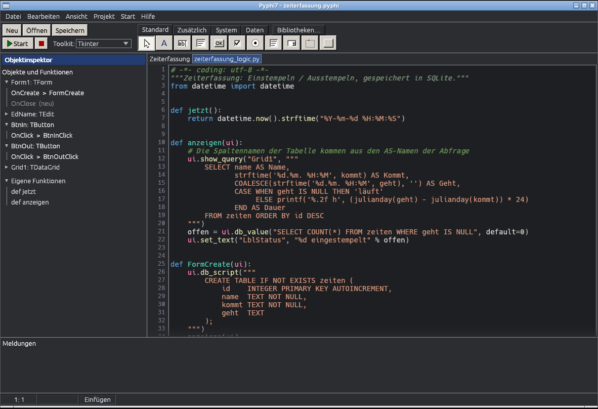

# Pyphi7

Ein Delphi-7-artiger visueller GUI-Designer für Python, geschrieben in Rust (egui).
Komponenten aus der Palette aufs Formular ziehen, Eigenschaften im Objektinspektor
ändern, per Doppelklick Ereignis-Funktionen anlegen – und Pyphi7 erzeugt daraus
Python-Code für **Tkinter** und/oder **Qt (PySide6)**. Deine Logik schreibst du
einmal in `<Projekt>_logic.py`, sie läuft mit beiden Toolkits.

## Bauen

    cargo build --release

Ergebnis: `target/release/pyphi7` (Windows: `pyphi7.exe`). Rust ab 1.95 nötig (rustup.rs).
Ohne eigenes Rust: Projekt auf GitHub hochladen – der Workflow `.github/workflows/windows.yml`
baut die `.exe` und stellt sie unter „Actions → Artifacts“ bereit.

## Benutzen

* Zum **Ausführen** der erzeugten Programme (F9) muss Python installiert sein
  (Tkinter ist dabei; für Qt: `pip install PySide6`).
* Komponente in der Palette wählen, im Formular klicken oder Rechteck aufziehen.
* Doppelklick auf eine Komponente → Funktion (z. B. `Button1Click`) im Code-Editor.
* F9 Start · Strg+F2 Beenden · F12 Formular/Code · Strg+S Speichern · Strg+Z/Y · Strg+D · Entf · Pfeiltasten.
* Projekte: `.pyphi` (alte `.pyrad` werden ebenfalls geöffnet). Deine `_logic.py` wird nie überschrieben.
* Beispiele: `beispiel/hallo.pyphi` (einfach) und `beispiel/komponenten.pyphi` (alle Komponenten).

## Code-Editor

* Python-Highlighting (Schlüsselwörter, Built-ins, Funktionsnamen/-aufrufe, `self`/`ui`, Zahlen,
  Strings inkl. f-String-Ausdrücke, Docstrings, Kommentare), Zeilennummern, aktuelle Zeile markiert.
* **Enter** rückt automatisch ein (nach `:` eine Ebene tiefer, nach `return`/`pass`/`break` zurück,
  zwischen `()`/`[]`/`{}` wird der Block aufgeklappt).
* **Tab** rückt zum nächsten 4er-Tabstopp ein, bei markierten Zeilen alle Zeilen; **Umschalt+Tab** rückt aus.
* **Rücktaste** in der Einrückung löscht eine ganze Ebene, zwischen leeren Paaren `()` / `""` beide Zeichen.
* **Strg+/** kommentiert Zeilen ein/aus. Klammern und Anführungszeichen werden automatisch geschlossen.

* Im Code-Editor zeigt die linke Seite statt des Objektinspektors eine Übersicht **Objekte und Funktionen**:
  alle Ereignisse jedes Objekts (belegte fett, „neu“ = noch keine Funktion), dazu eigene Funktionen.
  Klick springt zur Funktion bzw. legt sie an.

## Bibliotheken (pip)

Der Knopf **Bibliotheken…** (rechts neben den Palette-Reitern) öffnet ein Fenster, das installiert, aktualisiert und entfernt Python-Pakete per pip direkt aus Pyphi7
(Empfehlungen wie PyInstaller, PySide6, Pillow, requests … oder ein beliebiger Paketname). Die pip-Ausgabe
erscheint in den Meldungen. Es wird der Interpreter verwendet, mit dem auch F9 startet.

## EXE-Export

*Projekt → Als EXE exportieren…* erzeugt mit PyInstaller aus den Python-Dateien eine einzelne
ausführbare Datei (pro gewähltem Toolkit eine) im Ordner `dist/` neben dem Projekt; Bilder werden eingebaut.
Voraussetzung: Python und PyInstaller (Knopf Bibliotheken… → Installieren) (für Qt zusätzlich `pip install PySide6`).
Eine Windows-`.exe` entsteht nur unter Windows (PyInstaller baut immer für das aktuelle System).
Das Raster im Formular (Ansicht → Raster anzeigen) ist als Punktraster sichtbar.

## Dunkles Design

Menü **Ansicht > Dunkles Design** schaltet zwischen dem klassischen hellen Look und einem dunklen Design um
(auch Syntax-Farben im Code-Editor). Die Wahl wird gespeichert. Das Formular selbst bleibt immer hell,
weil so auch das fertige Tk-/Qt-Fenster aussieht.

## Code in VS Code (oder einem anderen Editor) schreiben

Pyphi7 beobachtet die Datei `<Projekt>_logic.py`. Speicherst du sie in VS Code, übernimmt Pyphi7 den neuen Text
nach einem Augenblick automatisch in den Code-Editor (Hinweis unter *Meldungen*) – ohne Neu-Laden, ohne Rückfrage.

* Steht im Pyphi7-Editor gerade etwas **Ungespeichertes** und die Datei ändert sich auch von außen, fragt Pyphi7 nach:
  *Ja* = Datei übernehmen, *Nein* = Editor behalten.
* Pyphi7 überschreibt deine Datei nie ungefragt. Neue Ereignis-Funktionen (Doppelklick im Formular) hängt es unten an.
* Das Formular (`.pyphi`) bearbeitest du weiterhin in Pyphi7; die Logik in dem Editor, der dir besser gefällt.

## Datenbank (SQLite)

Im Palette-Reiter **Daten**: *Database* (SQLite-Datei, wird bei Bedarf angelegt) und *Grid* (Datentabelle).
In der Logik: `ui.db_execute`, `ui.db_query`, `ui.show_query("Grid1", sql)` u. a. – siehe
`docs/FUNKTIONEN.md` und das Beispiel `beispiel/kontakte.pyphi`.

## Dokumentation

**Einstieg:** [Tutorial: Zeiterfassung in 10 Minuten](docs/TUTORIAL_ZEITERFASSUNG.md) – Einstempeln/Ausstempeln mit SQLite,
mit Screenshots (fertiges Projekt: `beispiel/zeiterfassung.pyphi`).

Alle Funktionen, Eigenschaften und Ereignisse der Komponenten: [docs/FUNKTIONEN.md](docs/FUNKTIONEN.md)

## Komponenten

Standard: Label, Edit, Memo, Button, CheckBox, RadioButton (GroupIndex = Gruppe), ListBox, ComboBox,
GroupBox, Panel (beide ziehen ihren Inhalt beim Verschieben mit). Zusätzlich: ProgressBar, TrackBar,
SpinEdit, Image. System: Timer.

* **Items / Lines** (ListBox, ComboBox, Memo): im Objektinspektor auf „…“ klicken → Zeilen-Editor.
* Schrift (Font.Size, Font.Bold, Font.Color), Hint (Tooltip), Color (Panel, Formular), Position (Formular zentrieren).
* Ereignisse: OnClick/OnChange, OnDblClick, OnEnter/OnExit (Fokus), OnKeyPress (`ui.key`), OnTimer, FormCreate, FormClose
  (darf `False` zurückgeben = nicht schließen).
* Formulargröße: Rand/Ecke des Formulars mit der Maus ziehen. Strg+Pfeile ändern die Größe der Komponente.
* Python-API für deine Logik: siehe Kopf von `<Projekt>_logic.py` (u. a. `get_value`, `set_value`, `add_item`, `set_image`, `set_interval`).

Kommandozeile ohne Fenster: `pyphi7 --generate projekt.pyphi tk,qt`
