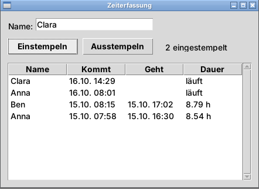
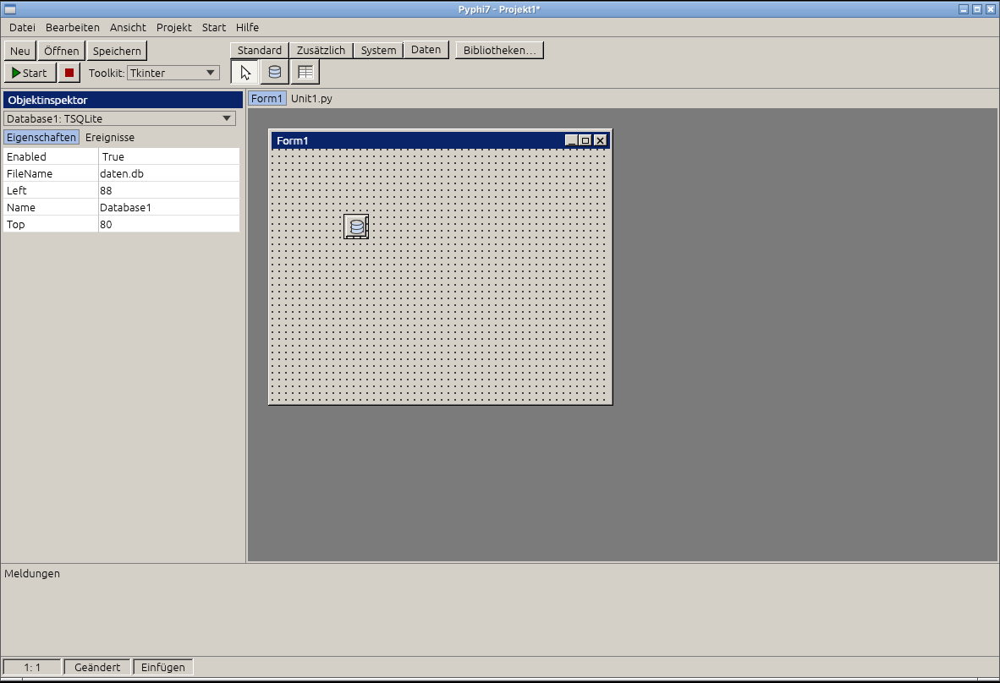
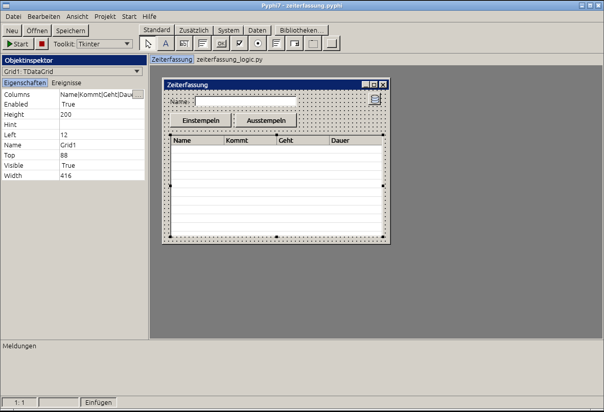
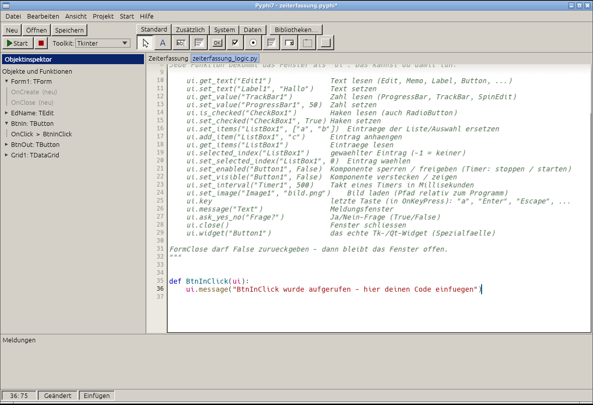
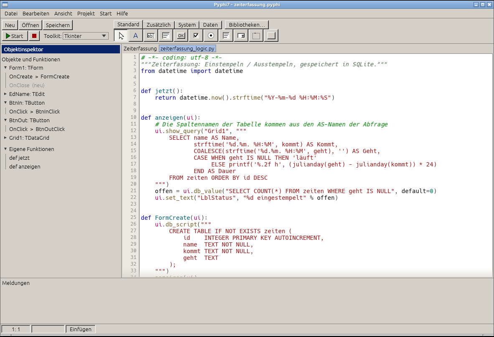
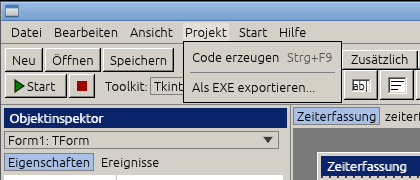

# Tutorial: Zeiterfassung in 10 Minuten

Ein kleines Programm zum **Einstempeln** und **Ausstempeln**, das alles in einer
**SQLite-Datenbank** speichert. Dabei lernst du die wichtigsten Dinge in Pyphi7 kennen:
Komponenten platzieren, Eigenschaften setzen, Ereignisse mit Code verbinden und die
`ui.…`-Befehle benutzen.

Das fertige Projekt liegt unter `beispiel/zeiterfassung.pyphi` – du kannst es zum Vergleichen öffnen.



---

## 1. Neues Projekt

Starte Pyphi7. Du siehst ein leeres Fenster **Form1**. Das ist dein Programmfenster.


Wichtig zu wissen:

- **Links** ist der **Objektinspektor**: Hier stehen die *Eigenschaften* (Aussehen) und die *Ereignisse* (was passiert bei einem Klick) des gewählten Elements.
- **Oben** ist die **Palette** mit den Reitern *Standard*, *Zusätzlich*, *System*, *Daten*.
- **Unten** erscheinen die *Meldungen* (Ausgaben und Fehler deines Programms).

Klicke auf die Fläche von **Form1** (nicht auf ein Element) und stelle im Objektinspektor ein:

| Eigenschaft    | Wert            |
|----------------|-----------------|
| `Caption`      | `Zeiterfassung` |
| `ClientWidth`  | `440`           |
| `ClientHeight` | `300`           |
| `Position`     | `poScreenCenter`|

Speichere mit **Speichern** als `zeiterfassung.pyphi`.
Dabei entstehen zwei Dateien: `zeiterfassung.pyphi` (das Fenster) und `zeiterfassung_logic.py`
(**dein** Code – wird von Pyphi7 nie überschrieben).

---

## 2. Die Datenbank-Komponente

Öffne den Reiter **Daten** und klicke auf das Datenbank-Symbol, dann einmal in das Formular.
Es erscheint ein kleines Symbol – es ist **unsichtbar im fertigen Programm** und dient nur dazu,
die Datenbank zu öffnen.



Setze die Eigenschaft `FileName` auf `zeit.db`.
Die Datei wird beim Start automatisch neben dem Programm angelegt.

---

## 3. Oberfläche bauen

Du setzt Elemente so: **Symbol in der Palette anklicken, dann im Formular klicken** (oder ein Rechteck aufziehen).
Mit der Maus verschieben, an den schwarzen Griffen vergrößern. Die Punkte sind das Raster, daran rasten die Elemente ein.

| Element (Reiter)  | Name        | Wichtige Eigenschaften                                |
|-------------------|-------------|-------------------------------------------------------|
| Label (Standard)  | `Label1`    | `Caption` = `Name:`                                   |
| Edit (Standard)   | `EdName`    | Text leer                                             |
| Button (Standard) | `BtnIn`     | `Caption` = `Einstempeln`                             |
| Button (Standard) | `BtnOut`    | `Caption` = `Ausstempeln`                             |
| Label (Standard)  | `LblStatus` | `Caption` = leer (wird per Code gefüllt)              |
| Grid (Daten)      | `Grid1`     | `Columns` = `Name\|Kommt\|Geht\|Dauer`                 |

**Tipp:** Der `Name` ist wichtig – mit genau diesem Namen sprichst du das Element später im Code an
(`ui.get_text("EdName")`). Ändere ihn im Objektinspektor in der Zeile `Name`.

So sollte es aussehen:



---

## 4. Ein Ereignis mit Code verbinden

Jetzt soll der Button etwas tun. **Doppelklicke auf den Button „Einstempeln“.**
Pyphi7 wechselt automatisch in den Code-Editor und legt die Funktion `BtnInClick` für dich an:



Das ist das Grundprinzip bei Pyphi7:

- Jedes Ereignis ist eine **Funktion mit dem Namen `<Element><Ereignis>`**, z. B. `BtnInClick`.
- Die Funktion bekommt **immer ein Argument `ui`** – das ist dein Fenster. Damit liest und ändert du alle Elemente.
- In der Liste links (*Objekte und Funktionen*) siehst du alle Elemente und ihre Funktionen und springst per Klick dorthin.

Der Kommentar oben in der Datei listet alle `ui.…`-Befehle. Du brauchst für dieses Programm nur wenige:

| Befehl | Was er tut |
|--------|------------|
| `ui.get_text("EdName")` | Text eines Elements lesen |
| `ui.set_text("LblStatus", "…")` | Text eines Elements setzen |
| `ui.message("…")` | Meldungsfenster anzeigen |
| `ui.db_script("…")` | mehrere SQL-Befehle ausführen (z. B. Tabelle anlegen) |
| `ui.db_execute("…", (werte,))` | ein SQL-Kommando ausführen (INSERT, UPDATE, …); gibt die Zahl geänderter Zeilen zurück |
| `ui.db_value("…", default=0)` | genau **einen** Wert aus der Datenbank holen |
| `ui.show_query("Grid1", "SELECT …")` | Abfrage ausführen und das Ergebnis in die Tabelle schreiben |

> Die Werte gibst du immer als `?` im SQL an und als Tupel dahinter: `("…", (name, jetzt()))`.
> Pyphi7 setzt sie sicher ein – so kann niemand Unsinn in die Datenbank schmuggeln.

---

## 5. Der komplette Code

Öffne `zeiterfassung_logic.py` im Code-Editor (Taste **F12** wechselt zwischen Formular und Code)
und schreibe Folgendes hinein. Du kannst es auch kopieren.



```python
from datetime import datetime


def jetzt():
    return datetime.now().strftime("%Y-%m-%d %H:%M:%S")


def anzeigen(ui):
    # Die Spaltennamen der Tabelle kommen aus den AS-Namen der Abfrage
    ui.show_query("Grid1", """
        SELECT name AS Name,
               strftime('%d.%m. %H:%M', kommt) AS Kommt,
               COALESCE(strftime('%d.%m. %H:%M', geht), '') AS Geht,
               CASE WHEN geht IS NULL THEN 'läuft'
                    ELSE printf('%.2f h', (julianday(geht) - julianday(kommt)) * 24)
               END AS Dauer
        FROM zeiten ORDER BY id DESC
    """)
    offen = ui.db_value("SELECT COUNT(*) FROM zeiten WHERE geht IS NULL", default=0)
    ui.set_text("LblStatus", "%d eingestempelt" % offen)


def FormCreate(ui):
    # Wird einmal beim Start des Fensters aufgerufen
    ui.db_script("""
        CREATE TABLE IF NOT EXISTS zeiten (
            id    INTEGER PRIMARY KEY AUTOINCREMENT,
            name  TEXT NOT NULL,
            kommt TEXT NOT NULL,
            geht  TEXT
        );
    """)
    anzeigen(ui)


def BtnInClick(ui):
    name = ui.get_text("EdName").strip()
    if not name:
        ui.message("Bitte erst deinen Namen eingeben.")
        return
    if ui.db_value("SELECT id FROM zeiten WHERE name = ? AND geht IS NULL", (name,)):
        ui.message(name + " ist schon eingestempelt.")
        return
    ui.db_execute("INSERT INTO zeiten (name, kommt) VALUES (?, ?)", (name, jetzt()))
    anzeigen(ui)


def BtnOutClick(ui):
    name = ui.get_text("EdName").strip()
    geaendert = ui.db_execute("UPDATE zeiten SET geht = ? WHERE name = ? AND geht IS NULL", (jetzt(), name))
    if geaendert == 0:
        ui.message(name + " ist nicht eingestempelt.")
    anzeigen(ui)
```

### Was passiert hier?

- **`FormCreate`** läuft beim Start. Es legt die Tabelle `zeiten` an, falls sie noch nicht existiert, und zeigt sie an.
  Damit diese Funktion aufgerufen wird, muss beim **Formular** im Objektinspektor, Reiter **Ereignisse**, bei `OnCreate` der Name `FormCreate` stehen
  (oder: Doppelklick in das leere Feld erzeugt ihn automatisch).
- **Einstempeln** schreibt eine neue Zeile mit der Startzeit; `geht` bleibt leer (`NULL`) – das bedeutet „läuft noch“.
- **Ausstempeln** setzt bei der offenen Zeile dieses Namens die Endzeit.
- **`anzeigen`** liest alles aus der Datenbank neu in die Tabelle. Das Ergebnis der Abfrage *ist* die Tabelle –
  die Spaltenüberschriften kommen aus den `AS`-Namen.

---

## 6. Starten

Drücke **F9** oder den grünen **Start**-Knopf. Pyphi7 erzeugt den Python-Code und startet dein Programm.
Tippe einen Namen ein und klicke auf **Einstempeln**, später auf **Ausstempeln**.


Fehler und `print()`-Ausgaben erscheinen unten im Bereich **Meldungen**.
Die Daten bleiben in `zeit.db` erhalten – beim nächsten Start sind sie wieder da.

> Ein bisschen Unsinn ausprobieren schadet nicht: Wer zweimal einstempelt oder ohne Namen klickt,
> bekommt eine Meldung statt eines kaputten Eintrags.

---

## 7. Als EXE weitergeben

Möchtest du das Programm jemandem geben, der kein Python hat?
Menü **Projekt > Als EXE exportieren…** (braucht PyInstaller, das du über den Knopf **Bibliotheken…** installieren kannst).



Die fertige EXE liegt im Ordner `dist` neben deinem Projekt; die Datenbank `zeit.db` wird neben der EXE angelegt.

---

## Weiter geht’s

- Alle `ui.…`-Befehle mit Beispielen: [FUNKTIONEN.md](FUNKTIONEN.md)
- Qt statt Tkinter: oben im Feld **Toolkit** umschalten – dein Code bleibt gleich.
- Ideen zum Erweitern: Spalte für Pausen, ein Knopf „Löschen“ mit `ui.ask_yes_no(...)`, Auswertung der Stunden pro Tag mit `SELECT name, SUM(…) … GROUP BY name`.
